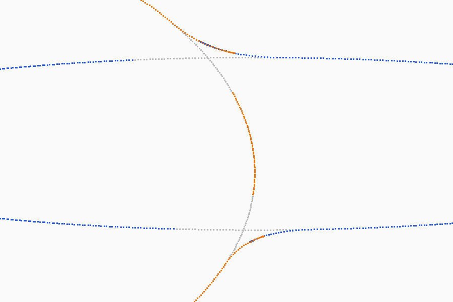

# Smooth Blend: a Live stack row that joins touching objects with a soft fillet (design)

Worker: claude/smooth-blend, 2026-11-07. Asked by Bolt through the coordinator: objects that meet (an
arm into a torso) join with a soft, adjustable fillet, live, with no raymarching and no topology
change. Technique chosen by Bolt: the idea of Implicit Skinning (Vaillant et al. 2013), with each
vertex near another object moved onto the smooth union of the two distance fields.

Mocks: `index.html` beside this file (three directions for the row and its With picker, desktop and
tablet). Spike picture: `spike-slice.png` (a z = 0 slice of the spike's result, section 4.6).
Reviewed by sm-architect on 2026-11-07; its findings are folded in (section 13 lists what changed).

## 1. What will exist
- A row **Smooth blend** (`Stack_Row.Blend`; `.Smooth` already names a cage row) in the Live stack
  card of a sculpt object, after Mirror, Array, Radial and Along (it blends what those rows draw).
  Its settings: **With** (chosen objects, or every object in the same folder), **Radius** (how far
  along each surface the fillet reaches), **Strength** (how full the fillet is, from a sharp crease at
  0 to a full round at 1), and **Fade with a painted weight** (an optional per-vertex weight painted
  with the existing mask brushes, which fades the blend out where it is painted).
- The row changes how the objects are shown, never what they hold: every vertex within reach of a
  partner is drawn moved onto the blended surface; the sculpt, its levels, mask, layers and undo are
  untouched. Strokes cost what they cost without the row.
- It is recomputed only when an involved object moves, is sculpted (after the stroke), or a value
  changes. Export, print export, the Blender link, boolean marks and **Apply** bake it like the other
  rows. Apply moves each involved object's vertices to where they were shown (topology unchanged, one
  undo step across the objects) and offers **Weld with Remesh** (Merge visible, then Voxel remesh,
  which exist) to make one closed mesh for printing.

## 2. Compare table (sm-design section 4)
| Part | Taken from | Why it still holds | Avoided | Done better |
|---|---|---|---|---|
| Joined look while parts stay separate | ZBrush Live Boolean (a union preview of subtools); SDF modellers (Womp's goop, Substance 3D Modeler, MagicaCSG, Dreams) | People block a figure from parts and want to see it as one form before committing | ZBrush shows a hard union only; SDF modellers lose the triangle sculpt (no 20M-poly detail, no levels) | A fillet over real sculpt meshes at any density, live, with the meshes' detail riding on it (4.5) |
| The field: distance to the other object | Implicit Skinning sampled each part's field once into 3D grids; OpenVDB and our `src/voxel` keep narrow bands in 8³ bricks | A field read from a grid costs a few loads; an exact BVH distance at 10M costs 6-28 µs a query (measured, section 10) | Implicit Skinning's HRBF fit per bone (rigid parts only); a dense grid (memory grows with volume) | Sparse bricks only where two surfaces are within reach of each other, in each object's own space, so a rigid move reuses every brick (4.3) |
| The sign | Bærentzen and Aanæs 2005, angle-weighted pseudo-normals of the closest feature | Exact for a closed manifold, from positions alone | Ray parity (breaks on any leak); fast winding numbers (Barill 2018) need a dipole tree per object; the stored vertex normals (wrong at concave creases, and owed by GPU sculpting for frames after a stroke) | The closest face, edge or vertex's angle-weighted normal from the positions; winding numbers stay the fallback for open meshes (open question 4) |
| The union operator | Gourmel et al. 2013, gradient-based blend: the amount of blend follows the angle between the two gradients | Plain smooth minimum bulges two parts that are only near each other into a bridge | Polynomial smin (Quilez) as SDF modellers use it: it bridges gaps and swells thin gaps shut | The smooth union's radius times a controller of the gradients' angle: full where surfaces cross, none where they face each other across a gap (4.4) |
| Moving the vertices | Implicit Skinning's Newton steps along the field gradient | Lands the fillet where a true field union puts it at steep angles | Pushing along the vertex normal (wrong place at steep crossings, folds) | Newton on the blended gradient, with the start point's own residual kept as detail, so wrinkles ride on the fillet (4.5) |
| Live and non-destructive | Blender modifiers, Nomad repeaters, our Live stack | Switch off, tune or apply at any time | A bake step before anything shows; a remesh that loses levels | Offsets drawn by the vertex shader from sparse pages; nothing under the sculpt changes |
| Weld for print | ZBrush DynaMesh, Blender voxel remesh, 3D-Coat voxel merge | A printer wants one closed shell | Making the remesh the blend (loses levels, density, every stroke's undo) | Apply bakes positions only; Weld with Remesh is a separate, optional step the toast offers |
| Fade it locally | Blender modifier vertex groups; our layer masks | An artist wants a crisp crease in one place and a fillet in another | A separate weight-paint mode | The mask brushes paint the weight, picked as layer masks are picked (section 5) |
| With | Blender Boolean's Collection operand; Womp groups | Whole limbs of a figure live in one folder | One operand per row | Chosen objects, or the row's folder, read live (a new object in the folder joins) |

**Rejected:**
- *Raymarch an SDF of the union* (Womp, Substance Modeler, Dreams): it needs an SDF of every sculpt
  (a 20M-vertex sculpt's SDF at sculpt resolution is gigabytes, or it loses detail), and a second
  renderer next to the mesh one (shadows, the studio, render mode, picking and partial redraw all
  redone). The fillet would not export as triangles without meshing. Our meshes stay the truth.
- *Remesh the joint* (DynaMesh, Blender's voxel remesh, a local remesh around the contact): it is a
  topology change on every move. That breaks the "no stroke cost" rule, drops levels and undo per the
  topology rule (AGENTS.md section 5), and cannot be live while dragging an arm.
- *Push vertices along their normals until they meet the other surface* (displacement by
  proximity): wrong at steep angles, and it folds at concave crossings. The spike's Newton lands in 3
  steps on average, so the right answer costs little more.
- *Blend in the vertex shader every frame*: 1.25M region vertices at 20M, times 3 Newton steps, in
  every pass (shadow, depth, colour, copies), every frame. The pages cache it once per change.

## 3. Where it sits
- Data: `Stack.blend: Stack_Blend` beside Mirror, Array, Radial and Along
  (`src/app/stack.odin:47-53`), and `Stack_Row.Blend` after `.Along` (`stack.odin:413-427`). The
  card draws it last, under a group renamed "COPIES AND JOINS" (open question 6).
- Order of evaluation: the rows above make the instances (the object and each copy, `stack_placings`,
  `stack.odin:227`). Smooth blend then works on instances: each instance of an involved object
  blends with each instance of the objects it is joined with. Copies of one object blend with each
  other too (radial petals meeting at the centre), except a Mirror row's image with its own half:
  they are one surface already, clipped at the plane (`stack_clip`, `stack.odin:264`).
- Pairs: an instance pair blends when either object's row names the other (With). Both sides move,
  since the fillet lies outside both surfaces, so a row on the arm also changes how the torso is
  drawn. The torso's card shows a read-only line "Joined with Arm (its Smooth blend)". A pair's Radius
  and Strength come from the row that names the other; when both name each other, the larger Radius
  and its row's Strength (open question 3).
- Not taking part:
  - hidden or ghost objects (`object_shown`);
  - voxel objects: surface nets remake their vertices. The picker refuses them with a reason (open
    question 5);
  - cages (Model mode has its own rows);
  - objects under dynamic topology, with an HD window open, or with a detail skin shown. The row's
    line says why: "Paused: dynamic topology", "Paused while the HD window is open", "Paused under the
    detail skin". The skin draws some chunks as its own grid, which would crack against blended
    chunks until P7.
- Elsewhere:
  - Boolean marks (`stack_shape_in`, `stack.odin:1287`, from `boolean.odin:120,151`) take the blended
    shape, since they go through `stack_bake`.
  - The Physics proxy keeps the unblended object, since it is a simulation stand-in (where it reads
    positions is UNVERIFIED).

## 4. The math
### 4.1 Fields
Each object O has a signed distance d_O(x) in its own space, negative inside. An instance with
placing M is a similarity (rotation, translation, uniform scale s: `Draw_Item.model`'s rule). The
partner's field at a point x of this instance's space is (s_self / s_P) · d_P(M_P⁻¹ M_self x). That is
one 4x4 transform per pair, applied per sample, so bricks never move with the objects.

### 4.2 Distance and sign from the BVH
- A sample at p: `geom.bvh_closest(s.bvh, mesh, p, band, hint)` (`src/geom/closest.odin:80`) gives
  the closest triangle and its barycentrics. The distance is exact.
- The sign is that of (p − q) · n, where n is the angle-weighted pseudo-normal of the closest
  feature (Bærentzen and Aanæs):
  - the face normal when all three barycentrics are inside;
  - the sum of the two faces' normals for an edge (one barycentric zero);
  - the angle-weighted sum of the vertex's faces' normals for a vertex (two zero), through the
    sculptor's vertex-face lists.
- It reads positions only, which has two consequences:
  - It is exact for a closed manifold, the concave crease included.
  - It needs no normals sync. GPU sculpting owes normals for frames after a stroke
    (`stroke_gpu.odin:143-160`), but the fill still waits for the positions to land, as LOD does
    (`stroke_gpu.pending`, `src/sculpt/lod.odin:158-166`).
- Open meshes have no inside. A sample whose closest feature is a border edge takes the sign of the
  nearest sample in its slice that has one.

### 4.3 The brick field (the cache)
- **Spacing:** h = 2^floor(log2(R/3)) for the blend reach R, a power of two, so h lies between R/6
  and R/3. Within one octave of h, the bricks and the band are filled for the octave's largest R
  (6h), so a Radius drag refills only when it crosses an octave. The spike used R/6 throughout (open
  question 7).
- **Bricks:** 8 cells each, stored as 9³ samples. Each brick holds its far faces, so a trilinear read
  never crosses into a neighbour: 13 % more samples, and no seams. Each sample is f32 distance + u8
  weight.
- **Which bricks:**
  1. The sculptor's nodes of this object whose boxes, moved into the partner's space, are within R of
     the partner's BVH (a box-box descent of its tree).
  2. The bricks overlapping those node boxes, dilated by one brick, since a vertex moves up to about R.
  3. A cull by one query at each brick's middle against both surfaces: |d| > R + half the brick's
     diagonal on either surface means empty, remembered as empty.
- **Ownership:** each object fills only its own field, into its own bricks; a pair reads both
  objects' bricks.
- **Lookup:** per pair, a dense grid of brick indices over the pair's overlap box. This is one load,
  where a hash or a binary search over keys would chain about 10 dependent loads per read on the GPU.
  Slots are given in sorted key order, so the cache's contents never depend on thread timing.
- **Filling:** one job per brick slice (9 rows of 9 samples), the hint chained along the slice. A
  sample with no surface within the band (R + h) is stored as ±(R + h), its sign taken from the
  nearest sample in the slice that has one (a sample that far cannot have a crossing between it and
  its neighbour).
- **Memory:** 9³ × 5 B = 3.6 KB a brick. The spike's arm-into-torso contact needed 136 bricks of 274
  marked, 774 KB for both objects' fields as f32 pairs (measured). Fields are kept per object and per
  h, and dropped when the object's topology or shown level changes.
- **Budget:** 64 MB per scene for fields and pages together, with least-recently-used eviction of
  bricks no pair needs now. Past the budget the row pauses and its line says why (the iPad's case).

### 4.4 The operator (Gourmel's idea on signed distances)
Gourmel et al. 2013 build their operator on compactly supported fields in [0, 1] (iso 0.5) and choose
the blend from the angle between the two gradients. We keep signed distances, because Newton needs a
field whose gradient is close to unit length, and carry the same idea over.

**Inputs.** a = d_self(x), b = d_partner(x), their unit gradients n_a and n_b, and c = n_a · n_b.

**Controller.**
- t = clamp((c + 0.8) / 0.5, 0, 1).
- k_eff = R · w · t²(3 − 2t).
- The blend is full where the surfaces cross, or meet with up to about 107° between their outward
  normals (c ≥ −0.3). It is off where they face each other across a gap (c ≤ −0.8), the case where
  plain smin builds a bridge. It is smooth in between.
- w is the product of both objects' painted weights at their closest points (section 5), so both
  sides see the same k_eff.

**Union.**
- h = max(k_eff − |a − b|, 0) / k_eff.
- G = min(a, b) − S · h² · k_eff / 4, where S is the row's Strength, 0 to 1.
- ∂G/∂(smaller argument) = 1 − S·h/2, and ∂G/∂(the other) = S·h/2.
- With k_eff = 0, G = min(a, b) exactly (the sm-sdf trap: never divide by k = 0).

**Reach.** The support is |a − b| < k_eff ≤ R. So the skip window, the band, the brick set and the
reach all use the same R, and nothing truncates the fillet. With k = R, the spike drew a fillet whose
largest lift is R/4 · S; P1's test measures where the tangent points land.

**Several objects.** Every field involved at a point is folded in one global order (object id, then
copy number): G = U(U(d₁, d₂), d₃)…, with each pair's own parameters (plain min for a pair that is
not joined). Every instance evaluates the same expression, so at a three-way junction the three sheets
project onto one surface. The controller and the weight terms (∂k/∂x) are left out of the gradient.
Newton then runs with an approximate Jacobian, which still converges because the controller varies
slowly where the blend is strong (the spike: 3.0-3.1 steps a vertex, none past 6).

### 4.5 Newton projection
For a vertex x0 of instance I:
1. Read the other fields at x0. Skip the vertex unless some joined partner has −R/2 < b < R. A vertex
   deeper inside a partner than R/2 is inside the union and hidden; the spike moved such vertices for
   nothing.
2. Set the target: solve G(x) = c, with c = a(x0) · (1 − h(x0)).
   - a(x0) is the brick field's own value at the vertex: 0 for an exact field; otherwise the trilinear
     error plus any detail finer than h.
   - Where h = 0 the vertex stays exactly where it was: no move outside the blend, so no step at the
     region's edge.
   - Detail the grid cannot hold stays as an offset over the fillet, fading to nothing at the seam,
     where both objects' vertices must meet. The spike solved G(x) = a(x0) without the fade.
3. Step: x ← x − (G(x) − c) ∇G / |∇G|². Each step is clamped to R/2, with at most 6 steps, stopping
   when |G − c| < 1e-4 · R.
4. Results:
   - the offset Δ = x − x0;
   - the field normal n_f, from central differences of the 9³ samples (the trilinear gradient is only
     C0 at cell faces and would facet a fillet three cells wide). P1 measures the normal error against
     the analytic union, and a normal pass over the moved region's triangles is the fallback;
   - the blend amount s = h(x): 0 at the fillet's edge, 1 at the seam.

Convergence and failure cases:
| Case | Result |
|---|---|
| Ordinary crossing | 3 steps on average (measured: 3.03 torso, 3.07 arm, none unconverged, 1M to 20M) |
| ∇G vanishes (a thin part's middle, gradients opposed) | the controller has already turned the blend off there (c ≈ −1); a step with \|∇G\|² < 1e-8 stops and keeps the last point |
| A step leaves the filled bricks | stop and keep the last point inside; the one-brick dilation makes it rare |
| Not converged after 6 steps | keep the point with the smallest \|G − c\| seen; counted in the exit stat `blend_unconverged` |
| Three objects at one spot | the global fold gives one field for all; each instance projects onto the same surface |
| Overlap at the seam | both objects' sheets reach the seam (the spike's picture shows them interleaved over one ring); the seam is cut by ownership (4.6) |

### 4.6 The seam between the two objects' sheets
Each object's moved vertices cover its side of the fillet up to the bisector a = b, and a ring past it
(vertices just inside the partner also flow past the bisector). Built in P2b (changed from the per-fragment
test the review proposed, which would have put a discard and brick reads into every mesh fragment variant):
- **One owner, the lower id.** Its vertices that would land more than `BLEND_SEAM_CUT` (0.05 R) past the
  bisector stay where they are, inside the partner and hidden; the partner's sheet reaches past the bisector
  to under the owner's. Only one side cuts, so no crack can open between two cut lines.
- **The owner stands a lift out** near the seam, fading to nothing by own = 0.5 so the fillet's edge keeps
  no step: `blend_seam_lift` = max(0.002 R, 0.75 e² / R), e the coarser sheet's mean edge
  (`Blend_Surface.edge`). The second term clears a coarse sheet's sagitta over the concave fillet: at
  20k against 1M (R 0.15) the bare 0.2 % left the coarse sheet's specks over the owner.
- **Nothing changes in the fragment stage**, so early-Z, the layered and area-light pipelines and shaded
  wire are untouched. The seam follows the owner's triangles.
- Checked in P2b: 1M against 20k, R 0.15, no background pixel inside the joint (55 533 dark pixels without the
  blend, 55 534 with, the one more a fillet in shade at 59 against a background of 54), no specks.

 The spike at 400k vertices, slice z = 0: grey before, blue the arm
after, orange the torso after. There are fillets at both crossings, and the overlap band of
interleaved points where the two sheets meet. The torso's part inside the arm moved too: it is hidden,
and the R/2 rule above skips it.

## 5. The weight mask
- **Storage:** `Sculptor.blend_weight: []u8` per vertex, nil until painted. 255 = no blend (fades
  out), the mask's convention (255 = brushes leave it), so "mask where you want no fillet" reads as
  masking.
- **Painting:** with every mask tool, by picking it the way layer masks are picked
  (`sculptor_layer_mask_pick`, `src/sculpt/layer_masks.odin:59-82`). The current machinery does not
  fit as it is, so it changes:
  - an explicit picked kind replaces the index (`Mask_Target{Sculpt, Layer, Blend_Weight}` with the
    layer's index), so unpicking never takes the `picked > len` branch that deletes `s.mask`;
  - weight steps set `Undo_Step.mask_layer = −1` (`undo.odin:54, 151`) and record `Blend_Weight` in a
    new `Undo_Step.mask_target`;
  - `Mask_Move` stays zero for the weight, since a picked layer mask moves the surface
    (`mask.odin:77, 302`) and a weight must not;
  - layer operations that unpick (`undo.odin:386`, `sculpt_layers.odin:486`) leave a picked weight
    alone.
- **Use:** the row's **Paint the fade** button picks the weight. The mask brushes, Clear, Invert,
  Blur, Grow and Mask by then work on it, and the mask's darkening shows it. A Done chip, or any
  level, HD or topology change, ends the pick.
- **Levels:** carried beside `levels_carry_mask` in `levels_set_current` (`levels.odin:131-133`).
  Remesh, decimate, every other topology change and dynamic topology (where `s.dyn` is set) drop it,
  as they drop the mask; the result line says so.
- **File:** written with the levels under a new `LEVELS_BLEND_WEIGHT` flag, in canon order, like
  `LEVELS_LAYER_MASKS`. No compatibility (AGENTS.md section 5).
- **In the field:** the fill samples the weight at each brick sample's closest point (a barycentric
  mix of the three corners), so both objects of a pair see one k_eff field and their sheets keep
  meeting.

## 6. Data and GPU buffers
| Data | Where | Size |
|---|---|---|
| `Stack_Blend{added, shown, folder: bool, with: [STACK_BLEND_WITH_MAX = 8]i32, radius, strength: f32, weighted: bool}` | `Object.stack` | written by `stack_put`/`stack_get` (`stack.odin:353-399`); `STACK_BYTES` grows; `stack_get` refuses a radius not finite or ≤ 0, a strength outside 0..1, or ids past 8; `SCENE_VERSION` 64 → 65 (`src/app/files.odin:84`) |
| Brick fields | `App.blend: Blend_State` (the app; geom does the work), per object and h | 3.6 KB a brick; about 0.4 MB an object for the spike's contact |
| Pair brick grids | `Blend_State`, per pair | one i32 per brick of the pair's overlap box |
| Instance pages | `render.Blend_Pages` per drawn instance (the object or a copy) | a page table, one u32 per 1024 vertices (78 KB at 20M), and 16 B per vertex of a touched page: float3 offset, then a u32 holding the field normal (oct, 2 x 12 bits), s (4 bits) and own (4 bits) |
| GPU copy of the bricks | `render.Blend_Field` | the brick atlas (f32 + u8 weight, 9³) and the pair grids, per object |
| Grown boxes | `Blend_State`, per instance | chunk boxes, group boxes and LOD group boxes grown by the largest \|Δ\| of their vertices, cones opened (cutoff 1) |

- **Pages are allocated by the kernel.** A pool of pages, handed out with an atomic counter as the
  projection finds a moved vertex in an untouched page, with an overflow flag and a retry with a larger
  pool. The pool cannot be sized from the scanned vertices, which would be 6.6M × 16 B = 105 MB at
  20M. Which slot a page gets depends on timing, but nothing drawn does. P1's bench prints touched
  pages and their bytes, which decide the pool's first size.
- **The vertex shaders read the pages.**
  - Which: `mesh.vert.slang` (plain and WIRE_BARY), `textured.vert.slang`, and `shadow.vert.slang`
    (studio shadow maps, and Live AO's `view_depth_draw`, `screen_pass.odin:126`).
  - `shadow.vert` today takes the position as a vertex attribute only (`shadow.vert.slang:8`). It
    gains `SV_VulkanVertexID` and a storage binding: a new layout, with new MSL and WGSL slot tables.
  - How: each reads `blend_table[vertex >> 10]` when the item has pages, adds Δ to the position and
    mixes the normal, n = normalize(lerp(n_mesh, n_f, s)), so a fresh stroke's detail still shades
    where s < 1.
  - Items without pages bind a one-word dummy (as `no_paint` does) and take a uniform branch; parity
    at 0 px.
- **Culling.** A page moves vertices out of their chunk's box, so a blended instance draws with grown
  boxes:
  - its chunk list, its groups and its LOD groups (`cull_lod` reads `Lod_Group.bounds` and cones,
    `geom/lod.odin:12-24`), kept in `Blend_State` per instance rather than remade in temp memory each
    frame;
  - GPU culling keeps one copy per mesh, re-uploaded only for a new `chunk_layout` or newer group
    stamps (`gpu_cull.odin:205-231`). So the group stamp an item passes is the larger of the
    sculptor's and a blend stamp, bumped for each group whose grown box changed.
- **Keys and redraw.**
  - Damage boxes, not a version in `frame_key`. When pages change, the item's damage box is the union
    of the old and new region boxes. A version in `frame_key` would force a full redraw and make the
    damage box moot (`renderer.odin:1716-1720, 1777-1823`).
  - The pages' version goes into `static_key` (`renderer.odin:2120-2166`) and `studio_scene_key`
    (`studio.odin:362-374`).
  - The partners of a dragged object are drawn live while their pages change, or the idle cache would
    be redrawn every frame.
- **Copies.** Each `Draw_Item` copy (`stack_draw_copies`, `stack.odin:274`) binds its own pages,
    grown boxes and damage; copies out of contact bind none.
- **Traced studio and render mode.** Both build trees from unblended positions (`trace.odin:406, 448,
  593`; `path.odin:1015, 1141`). Until P7, `trace_prepare` returns false while any item has pages, so
  the studio falls back to the gather path, which is never half done. Render mode stays unblended and
  says so in its line until P7, which gets its own design.

## 7. Recompute rules and the stroke
| Event | Bricks | Pages |
|---|---|---|
| A stroke runs on any object | frozen (nothing read or written); no projection dispatch | frozen. The shader adds the old Δ to the new position and mixes the new mesh normal, so the stroke shows where it lands |
| The stroke ends (or undo or redo of one) | once `stroke_gpu.pending` is clear: refill this object's bricks within the stroke's changed box + R | re-project this object's instances, and every partner instance's vertices within that box + R |
| An object moves (gizmo, Transform values, Align, Distribute) | none, since bricks live in object space; fill the bricks the new contact needs that are not cached | re-project the pairs it is in; the old region's pages are cleared |
| Radius crosses an octave of h | fill at the new h (the old h stays cached) | re-project all pairs of the row |
| Radius within an octave, Strength, With, weight on or off | none | re-project |
| The blend weight is painted (a mask step on it) | refill the weights of bricks within the painted nodes' box | re-project there |
| Hide, show, ghost, delete or undelete an object, or move it into or out of the row's folder | none | pairs added or removed; the pages of instances that lost every partner are freed |
| A level change of the object or of a partner, an HD window, a dyntopo toggle, remesh, any rebuild | drop that object's bricks (a partner's drop its pair grids) | rebuilt from scratch when the row takes part again |
| A row of copies changes | none | instances added or removed |

**The rule that sculpting must never hitch (2026-11-03).**
- During a stroke the row does nothing on the CPU. On the GPU it costs only the page read in the
  vertex shader: one storage load per vertex from an 80 KB table, plus 16 B per moved vertex. No
  projection is dispatched in a frame where a stroke runs.
- After the stroke, the work is queued like the simplified copies' builds (`sculptor_lod_update` with
  `LOD_FRAME_BUDGET`, `src/sculpt/lod.odin:32, 158`):
  - bricks are filled on the pool within `BLEND_FRAME_BUDGET` (2 ms) a frame, after the GPU stroke's
    positions have landed;
  - an instance's projection runs as one GPU dispatch once its bricks are complete;
  - a new stroke pauses the queue, which resumes at the stroke's end.
- So the blend may catch up a few frames after a stroke at 10M and above, but the stroke itself never
  waits.
- The GPU kernel lands before the row is offered (P3 before P4), because the CPU projection's 124-218
  ms at 10-20M would make a gizmo drag lag by seconds, even sliced.
- Proof: a `--bench-stroke` A/B with and without a row, back to back, at 10M and 20M (brush_ms,
  frame_ms, brush p99, frame p99, gpu_ms), also measured on the frames after a stroke and after an
  undo.
- Autosave reads meshes on its own thread at rest (`autosave.odin:4-12, 451-470`); the fill reads them
  on the frame's pool at rest. Both only read. Apply stops autosave first, like every scene command.
  Whether the jobs pool may be fed while autosave runs is UNVERIFIED; P4 checks it, and the fill
  never runs on the autosave thread.

**Picking and the brush.** Brushes act on the objects as they are, under the fillet, as ZBrush's Live
Boolean sculpts the parts rather than the preview. Near the seam the cursor ring may sit under the
drawn fillet, and picking on the fillet hits the object surface behind it. Accepted for v1 (open
question 8).

## 8. Undo, levels, HD, LOD, export and Apply
- **Undo.** The row's values are the Stack's (`stack_set`, `stack.odin:312`; a slider drag is one
  step, `stack_drag_end`). Bricks and pages are derived and never undone. Weight painting is a mask
  step (section 5).
- **Levels.** Only the shown level is blended; bricks and pages are per level and rebuilt on a level
  change. Lower levels are never moved by the row.
- **HD.** An HD window on an involved object pauses the row for that object: its pages are dropped
  while the window is open, since the window's level is drawn separately and its border never moves.
- **LOD.** Simplified copies reuse the level's vertices, so the vertex shader moves them too. Their
  grown group boxes keep culling right (section 6). Copies are never built during a stroke, as now.
- **Export, print, the Blender link and boolean marks.**
  - `stack_bake` (`stack.odin:1223`) gains the blend, done by the CPU reference, bit-identical serial
    and parallel.
  - It takes raw positions and indices today, so for the blend it builds its own BVH and bricks: an
    estimated 0.6-0.9 s at 10-20M, run as a long job past 2M.
  - Objects that are joined by a partner's row, without a row of their own, bake too.
  - The GPU's pages are for display only; a test holds them within 1e-5 of the CPU reference.
  - With the Export sheet's "Bake the live stack" off, the parts export unblended.
- **Apply** (the row's own Apply, or Apply stack) changes positions only, with the topology kept
  (sm-cad's first path):
  1. For each involved object, a step that records its moved nodes and sets them through
     `sculptor_nodes_moved` (`src/sculpt/brush.odin:1965`), following `smooth_all.odin:99`.
  2. The steps are chained in the History as one entry (`history.odin:60, 239, 283-288`), and the row
     is removed.
  3. The toast offers **Weld with Remesh** (Merge visible, then Remesh at the merged count), using the
     existing commands.
  - A Mirror or Array row applied with it bakes first: the copies become geometry, the bake runs the
    CPU reference on the baked mesh's instances, then joins them.

## 9. Packages and files
- `src/geom/blend_field.odin` (new): `Blend_Bricks`, `blend_bricks_fill(b, mesh, bvh, faces, weights,
  keys, h, band, pool)`, `blend_field_at(b, grid, p) -> (d, grad, w, ok)`, and the pseudo-normal sign.
  Pure, `jobs` only (already imported, `geom/bvh.odin:8`).
- `src/geom/blend.odin` (new): `Blend_Params`, `blend_union(...)`, the global fold, and
  `blend_project(...)`, the CPU reference.
- `src/render/blend.odin` + `shaders/blend_project.comp.slang` (new kernel), the page read in
  `mesh_io.slang`, the new `shadow.vert` layout;
  `Draw_Item.blend: ^Blend_Pages`.
- `src/sculpt`: `Sculptor.blend_weight`, `Mask_Target`, the undo field, the carry and the file flag.
  sculpt knows nothing of blending: this is an extra paintable weight.
- `src/app/blend.odin` (new): `Blend_State`, the queue, the invalidations, the grown boxes, the card
  body (`kit_stack_blend`), the With picker, the joined-with line, and the script verbs
  `stack blend on|off`, `stack blend with ID...|folder`, `set blend_radius` and `set blend_strength`.
- Boundaries: geom imports nothing new; render reads no app state and no UI; the app holds an opaque
  `render.Blend_Pages`, as it holds `render.Texture`.

## 10. Budgets (Radeon 890M, Ryzen AI 9 HX 470 with 24 threads, release)
How these were measured:
- a discarded CPU spike: two intersecting shapes, the torso with 3/4 of the vertices and the arm with
  1/4, R = k = 0.12, h = R/6, built with `-o:speed -no-bounds-check`, 24 threads;
- **while other agents loaded the machine to a load average of 37-43 on 24 threads.** Every wall time
  below is likely 1.5-2.5x pessimistic; P1's `bench --blend` re-measures them alone.

| Quantity | 1M | 10M | 20M | |
|---|---|---|---|---|
| vertices moved, both objects | 62.6k | 627k | 1.25M | measured |
| vertices scanned (in chunks near the partner) | 373k | 3.5M | 6.6M | measured |
| projection on the CPU, fields from bricks, 24 threads | 14-18 ms | 124-140 ms | 218 ms | measured (loaded) |
| projection per moved vertex, 2 threads | 1.7 µs | | | measured |
| projection on the GPU (the kernel) | ~0.3 ms | ~1.5 ms | ~3 ms | estimated: 3 steps × 2 trilinear reads (16 loads, bricks in L2) per moved vertex, plus one position read per scanned vertex |
| one exact closest-point query, 1 thread, at ±0.05 and ±0.14 from the surface | 2.5-9.6 µs (750k) | 6.4-28.8 µs (7.5M) | | measured |
| brick samples per contact (both objects, h = R/6) | 199k | 199k | 199k | measured; independent of density |
| brick fill, exact queries, 24 threads | 146-173 ms | 644 ms | ~900 ms | measured at 1M and 10M; 20M estimated from the density trend |
| brick fill from a 100k-vertex stand-in mesh | 72-175 ms | 126 ms | 103 ms | measured (noisy) |
| field memory per contact | 774 KB | 774 KB | 774 KB | measured |
| pages | ~6 MB | ~55 MB | ~105 MB worst case | estimated from the scanned vertices; the touched pages are fewer. P1 measures them, and the 64 MB budget may pause the row at 20M |
| stroke cost with the row against without | 0 on the CPU; on the GPU, one load a vertex | same | same | estimated; A/B in P4 |

What this means:
- **The projection belongs on the GPU,** as the coordinator asked: on the CPU it is 220 ms at 20M,
  which would make a drag lag by seconds under the 2 ms budget. On the GPU it is one dispatch.
- **The brick fill is the cost that matters.** It is per contact, not per vertex, and cached across
  rigid moves, so a drag fills only the bricks its contact newly enters. A first contact at 10M
  settles in about 0.6 s of pool time (about 0.3 s unloaded, estimated), spread over frames. At h = R/3
  the samples drop by up to 8x. P6 measures whether a fill from the simplified copies (the measured 5x
  at 10M) or a GPU fill is worth adding.
- **Targets for the PRs:**
  - the stroke A/B within run-to-run noise (brush_ms, frame_ms p99, gpu_ms);
  - `gpubench` orbit with a row at most 3 % slower (the discard's early-Z cost included);
  - after a stroke at 10M, the blend settles within 0.5 s, with no frame more than 2 ms over its
    unblended time;
  - in a gizmo drag at 10M, the fillet follows within 3 frames for moves under a brick a frame.
- **P1's bench prints, at 1M, 10M and 20M, run alone with the load average:**
  - bricks marked and kept, and samples;
  - fill ms at 1 and 24 threads, and query µs at p50 and p99;
  - scanned and moved vertices, touched pages and their bytes;
  - mean and largest steps, and the unconverged count;
  - the error against the analytic sphere-sphere union, and the normal error;
  - each at h = R/3 and R/6, and filled from the LOD stand-in.
- **Exit stats:** `blend_fill_ms`, `blend_project_ms` (a GPU span), `blend_bricks`, `blend_moved`,
  `blend_pages_kb`, `blend_unconverged`, `blend_pending` (bricks waiting).

## 11. PR split (each under ~300 lines where it can be, each with its evidence)
1. **P1 geom: field and projection, the CPU reference.** `blend_field.odin` with the pseudo-normal
   sign, `blend.odin` with the global fold, tests, and `bench --blend` with the rows in section 10.
   Tests:
   - a sphere into a sphere: every moved vertex on the analytic smooth union within 1e-3 of R, and its
     normal within a measured angle;
   - no vertex moves where h = 0;
   - two parallel planes R/2 apart do not move (the controller);
   - three spheres at one point project onto one surface;
   - serial == parallel bit for bit, and a deterministic brick fill;
   - the failure cases counted.
   Evidence: tests, and bench rows run alone on the machine.
2. **P2a render: pages in the vertex shaders.** `Blend_Pages`, the page read in the mesh, wire,
   textured and shadow vertex shaders (the shadow layout is new, with its MSL and WGSL tables), and a
   dummy for items without pages. Evidence: parity_check at 0 px without pages, and smoke.
3. **P2b render: what pages change.** Grown chunk, group and LOD boxes, GPU-cull stamps, damage boxes,
   `static_key` and `studio_scene_key`, the seam's owner and lift (geom), and
   `--blend-test` filling pages from P1's CPU reference for two spheres at mismatched densities (1M
   against 20k). Evidence: `--dump-cull` with no mismatch, a described dump, background pixels inside
   the silhouette counted at the seam (0 expected), and gpubench orbit with and without.
4. **P3 the GPU projection kernel.** `blend_project.comp.slang`: one dispatch per instance, pages from
   a pool. The CPU path stays for export, tests and devices without compute. Evidence: pages within
   1e-5 of the CPU's (a test through a readback), `kernel_stats.py`, and bench at 1M, 10M and 20M.
5. **P4 app: the row.** `Stack_Blend`, the file bytes (version 65), the card body and With picker per
   the chosen mock, the joined-with line, the queue (waiting on `stroke_gpu.pending`), the
   invalidation table, the studio's fallback to gather, skinned objects paused, the script verbs, and
   README "Live stack". Evidence:
   - tests (stack bytes, script and undo);
   - a described dump of an arm in a torso;
   - the `--bench-stroke` A/B at 10M and 20M;
   - touch scenarios for the card.
6. **P5 the painted weight.** The sculpt `Mask_Target`, the undo field, the levels carry, the file
   flag, and Paint the fade. Evidence: sculpt tests (undo, carry, file round trip), and a dump with a
   faded region.
7. **P6 copies, Apply and export.** Instances per copy, copies blending with each other, `stack_bake`
   with its own BVH and bricks, partners without rows, Apply as chained steps, and the Weld with Remesh
   offer. Also the fill speed decision, made by bench: a stand-in from the simplified copies, or a GPU
   fill. Evidence: export_check, mesh_check after Apply then Weld, and bench.
8. **P7 the other drawing paths** (detail skin, textured preview, traced studio, render mode): a
   design of its own first.

P1 and P2a can run in parallel, since they share no files. P2b needs P1, P3 needs P2b, and P4 needs
P3.

## 12. Open questions (each with the default taken)
1. Both objects move, or only the one with the row? **Default: both,** since a fillet lies outside
   both surfaces; a one-sided blend leaves a ledge at the seam (4.6).
2. Copies blending with each other (radial petals): **default yes** for Array, Radial and Along;
   never a Mirror image with its own half.
3. Two rows naming each other with different values: **default the larger Radius, and its Strength.**
4. Open meshes (imports with holes): **default allowed, with the sign from the pseudo-normal,** and a
   hint in the row when the object is open. Winding numbers only if a real file shows the need.
5. Voxel objects: **default excluded in v1.** Later, a clay partner can read its own SDF directly.
6. The card's caption for Mirror to Along and Smooth blend: **default "COPIES AND JOINS".**
7. Field spacing: **default h = 2^floor(log2(R/3))** (R/6 to R/3), filled for the octave's largest R.
   P1's test decides: the fillet within 1e-3 of R of the analytic union, and the normal error.
   Fallback: R/6 throughout.
8. The brush ring and picking on the drawn fillet: **default: act on the objects as they are** (v1).
   Picking through the pages is a later step, if Bolt finds it confusing.
9. Weight convention: **default "paint to fade out"** (255 = no blend), matching the mask.
10. k = R or 2R: **default k = R** (the spike's value), so every reach agrees (section 13).
11. Memory cap: **default 64 MB per scene** for fields and pages; past it the row pauses with a line
    saying why.

## 13. What the architect's review changed (2026-11-07)
| Finding | Change |
|---|---|
| k = 2R against the reach, band and bricks at R left a step of S·R/8 at the fillet's edge | k = R everywhere (4.4) |
| The derivatives left out Strength | ∂G = 1 − S·h/2 and S·h/2 (4.4) |
| Folding the fields self-first gives each object a different surface at a three-way junction | one global fold by object id, with per-pair parameters (4.4) |
| The sign read stored normals: wrong at concave creases, and owed by GPU sculpting after a stroke | Bærentzen pseudo-normals of the closest feature, from positions (4.2) |
| own interpolated per vertex cuts two tessellations along different chords, so cracks show the background | one owner that cuts past the bisector and stands a lift out, no fragment test; checked in P2b at 1M against 20k (4.6) |
| The clip pipelines drop material layers, area lights and shaded wire | no fragment test at all (4.6) |
| GPU culling and LOD never see grown boxes; copies need their own | grown chunk, group and LOD boxes per instance; a blend stamp for GPU cull (6) |
| The keys: a version in frame_key makes damage moot, and studio_scene_key was missed | damage boxes; the version in static_key and studio_scene_key; partners drawn live (6) |
| shadow.vert has no vertex id or storage | a new layout with MSL and WGSL tables (6, P2a) |
| Skins, the traced studio and render mode stay unblended | skins pause the row; the studio falls back to gather; render mode waits for P7's own design (3, 6) |
| The CPU projection in P3 would make drags lag | the GPU kernel moved before the row (P3 before P4) |
| The fill must wait for GPU strokes' positions | it waits on `stroke_gpu.pending`, as LOD does (7) |
| Layer-mask picking deletes, moves the surface and indexes layers | an explicit `Mask_Target`, `mask_layer = −1`, no `Mask_Move` (5) |
| A binary search per brick read is about 10 dependent loads | a dense brick grid per pair (4.3) |
| Pages sized from scanned vertices are about 5x the estimate | pages from a GPU pool; P1 prints touched pages (6, 10) |
| stack_bake has no BVH; joined partners without a row; file validation; invalidations missing hide, ghost, delete, folder and a partner's level | all added (6, 7, 8) |

## 14. Learned while building (P2a, P2b)
- The sculptor's tree has a node of triangles a leaf (1024): far too coarse for closest-point queries. The
  `--blend-test` harness builds a 16-triangle lookup tree per object; the row (P4) needs a cheaper one, over
  only the triangles near the contact, refit after strokes.
- Grown boxes are found per chunk, once per fill: each touched page's moved vertices at rest, queried in the
  sculptor's tree (whose leaves are the chunks). A slab round the whole region opened 3x the chunks' cones.
- The simplified copies' groups are built in place a few a frame under the same tree, so their grown copy is
  made every frame (it is small); caching it kept every group stale and drew no copy at all (4.5M triangles
  drawn against 0.27M).
- Orbit cost with pages, release, two 2M spheres, 318k moved vertices: GPU p50 1.45-1.46 ms against
  1.41-1.68 ms plain, CPU 0.448-0.454 against 0.434-0.441 ms, triangles 272k against 266k.
